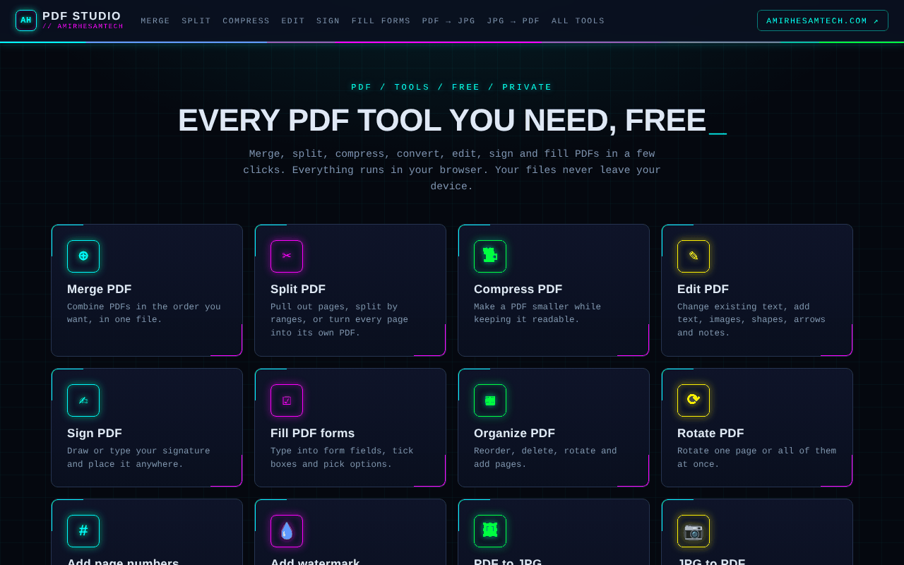
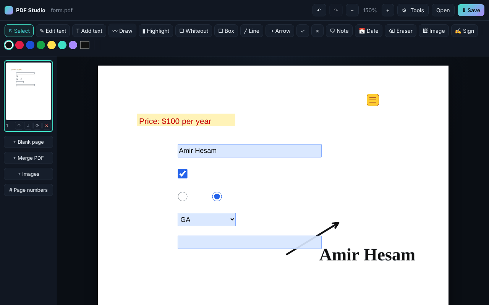
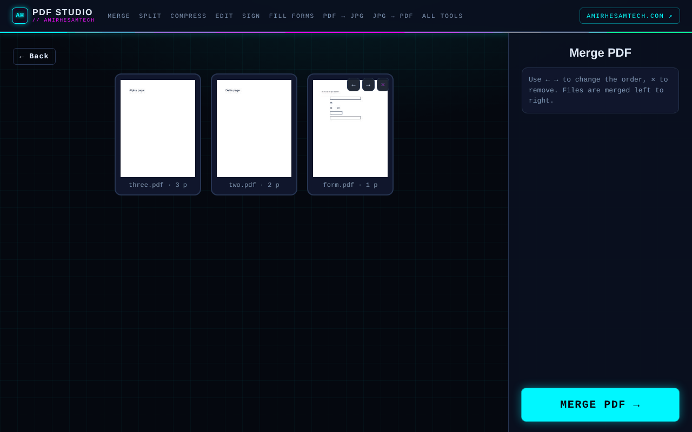
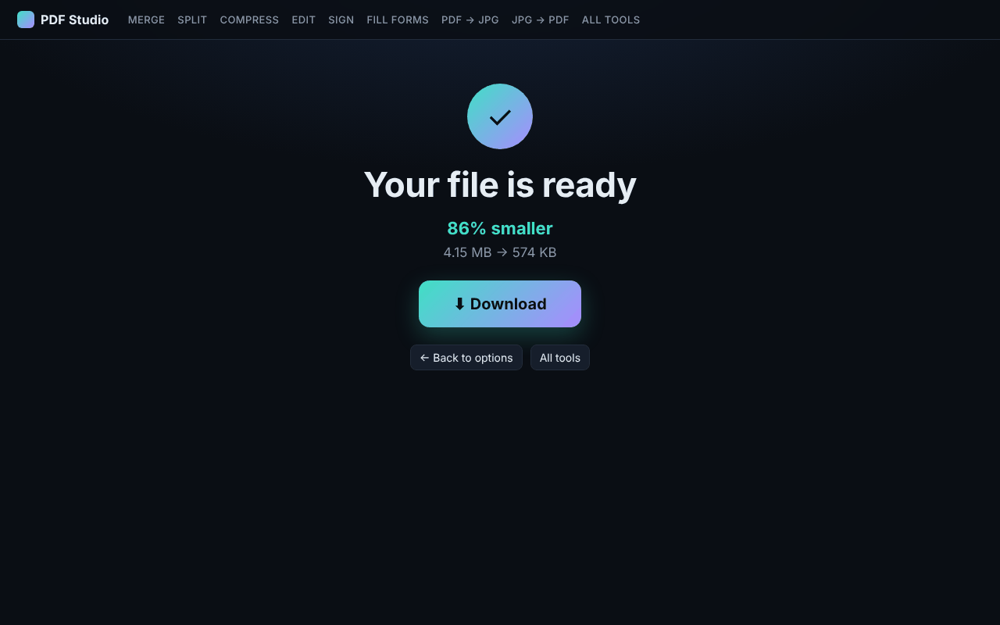

# Free Online PDF Editor — PDF Studio

[](https://github.com/amirh3sam/FreeonlinePDFeditor/actions/workflows/tests.yml)

**▶ Live: https://freeonlinepdfeditor.vercel.app**

Every PDF tool you need, free and private. It all runs in your browser: no uploads, no sign-up, no watermarks.



| Editor: fill forms, edit text, sign, annotate | Merge |
|---|---|
|  |  |
| **Watermark (live preview)** | **Compress** |
|  |  |


## Tools

| Tool | What it does |
|---|---|
| **Merge PDF** | Combine PDFs in any order |
| **Split PDF** | Pick pages, split by ranges, or every page as its own file (.zip) |
| **Compress PDF** | Shrink scans and photo-heavy PDFs (3 levels) |
| **Edit PDF** | Click existing text to change it (color and font matched), add text, images, shapes, lines, arrows, ✓/✗, date stamps and sticky-note comments |
| **Sign PDF** | Draw or type a signature. Saved signatures can be reused with one tap |
| **Fill PDF forms** | Type into text fields, tick checkboxes and radio buttons, pick from dropdowns |
| **Organize PDF** | Reorder, rotate, delete, add blank pages or more PDFs |
| **Rotate PDF** | Rotate single pages or all of them |
| **Add page numbers** | 6 positions, 3 formats, custom start number |
| **Add watermark** | Text watermark, centered or tiled, any angle, color or transparency |
| **PDF to JPG** | Every page as a JPG (.zip) |
| **JPG to PDF** | Photos into one PDF, with page size, orientation and margins |

Each tool has its own link, for example `/#merge`, `/#compress` or `/#sign`.

The editor also has highlight, whiteout, box, freehand drawing, undo/redo, zoom, and a page sidebar.

Keyboard shortcuts in the editor: `V` select · `X` edit text · `T` add text · `D` draw · `H` highlight · `W` whiteout · `B` box · `L` line · `A` arrow · `N` note · `E` eraser · `Ctrl+Z`/`Ctrl+Y` · `Ctrl+S` save · `Delete`.

## Tests

57 automated end-to-end tests ([Playwright](https://playwright.dev) + `node:test`) cover every tool and option. They don't just click through the app: each test opens the downloaded file and checks what's inside, including page count, rotation, extracted text, embedded images, zip contents and JPG pixel sizes. They run on every push via GitHub Actions.

```bash
cd tests && npm install && npx playwright install chromium && npm test
```


## How it works

It's a single static `index.html`. These libraries load from cdnjs:
- [PDF.js](https://mozilla.github.io/pdf.js/) for rendering, text detection and form fields
- [pdf-lib](https://pdf-lib.js.org/) for writing edits, filling and flattening forms, merging and splitting
- [JSZip](https://stuk.github.io/jszip/) for multi-file downloads

Your edits are written into the original PDF, so the existing text stays real, selectable text.

## Limitations

- **Edit text** covers the original text and redraws it in the closest standard font (Helvetica, Times or Courier). It works best on single lines.
- Filled forms are flattened when you save, so the values become part of the page and the fields are no longer editable.
- Compression converts pages into images. It's great for scans, but text stops being selectable.
- Password-protected PDFs can't be opened. Office conversions (Word, Excel) aren't supported, because they need a server.

---
Built by [AmirHesam Tech](https://amirhesamtech.com)
